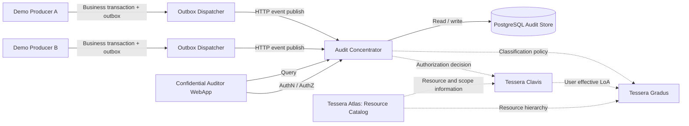

# Arcanum — Architecture (working draft)

Status: **proposed**, not an implementation specification.

## Context and components



Dashed relations represent **conceptual responsibilities**; they need not be network calls or separate runtime services in V1.

## Audit prototype architecture

- Backend: **.NET Minimal API**.
- Store: **PostgreSQL**.
- Producers: two demonstrators with distinguishable classifications/visibility.
- Outbox record and business mutation are saved in the same local **Unit of Work**; the dispatcher retries on failure and delivers at least once.
- Shipping: HTTP POST to the Concentrator; the producer treats receipt as delivered **only after successful durable ingestion**.
- The Concentrator enforces producer identity, payload validation, classification and idempotent persistence; duplicate IDs with conflicting payloads are rejected.
- Workflows are chains of narrowly responsible, reusable activities (Chain of Responsibility). A typed request context carries state and a scoped service provider / next delegate; a dedicated response middleware translates workflow results to HTTP.
- No distributed transaction between a producer and the Concentrator.

### Event contract: conceptual schema

```json
{
  "event": {
    "uuid": "<uuid>",
    "original_timestamp": "<utc>",
    "type": "PROFILE_UPDATE",
    "application_uuid": "<registered application uuid>",
    "actor_type": "USER",
    "actor_issuer": "<identity namespace>",
    "actor_subject": "<subject within issuer>",
    "auditable_subject_uuid": "<uuid>",
    "auditable_subject_public_note": "<displayable note>",
    "related_event": null
  },
  "event_details": { "details": { "changed_fields": ["phone"] } },
  "confidential_search_terms": [
    { "term_type": "email", "term_value": "user@example.test" }
  ]
}
```

This payload mirrors the logical Concentrator model. Database IDs, server-side ingestion timestamp and *effective* event/detail LoA are assigned **by the Concentrator**. The precise JSON field names and validation rules require a contract review before implementation. `related_event` is only accepted for internal Confidential Auditor events.

### Data and policy principles

- `event` stores origin actor identifiers: `actor_type`, `actor_issuer`, `actor_subject`; it does **not** use `user_id` to mean an auditor querying the event.
- `event_details` has its own classification, independent of (but access dependent upon) the parent event. Detail access requires authorization for **both** the event and the detail.
- Original audit event remains unchanged when queried; query/denial generates a separate audit event, without recursive self-auditing.
- Classification policy initially uses **application + event type** and can later be expressed over a generic resource catalog.
- User LoA is ordered numerically; prospective domain constraints (e.g. department) are evaluated separately.
- Authorization: `HasPermission(user, action, resource) && EffectiveLoA(user, resource) >= RequiredLoA(resource) && ScopeAllowed(user, resource)`.
- HMAC-SHA256 equality index uses a secret Concentrator key and **type-based domain separation**, with consistent per-type normalization; no per-application derivation for the V1 transversal-search use case. Search results apply authorization filtering **before pagination**. Plaintext term values and details remain unencrypted in V1.
- For future encryption, only **public keys** may be distributed to producers; private keys remain controlled by the Concentrator/HSM. HSM integration is not a V1 abstraction commitment.

## Generic resource model — proposal

Start with a **canonical tree** for resource containment/policy inheritance and a separately typed **relation graph** for cross-cutting links. Keep physical resource paths distinct from policy selectors.

Candidate concepts: `resource_type`, `resource` (parent/path/attributes), `resource_relation`, `classification_policy`, `resource_access_policy`. Avoid materializing every database value or audit event as a catalog node; use selectors for sets of dynamic resources. **Decision pending:** selector language, propagation and conflict resolution, reclassification semantics, cross-scope permissions.

## Technology evaluation

- PostgreSQL adjacency list + `ltree` (candidate) for canonical resource hierarchy, plus typed edge table for ancillary relations.
- .NET for API, workflow orchestration and initial policy evaluation.
- **OPA** as policy-expression and query-filtering experiment; **OpenFGA** as relationship-authorization experiment. Neither is approved as a dependency.
- React/TypeScript as a candidate for the auditor and governance consoles.
- Compare SQL-backed policy filtering, explanation and performance before choosing policy infrastructure.

## Core quality requirements

- Durable, idempotent ingest and auditable authorizations.
- No disclosure of unauthorized event/detail fields; filter before pagination.
- Deny access when classification/policy cannot be resolved, rather than assuming public.
- Preserve policy/version context for future audit reconstruction; precise versioning model pending.
- Keep V1/demo plaintext limitations visible; never market it as cryptographically protected.
