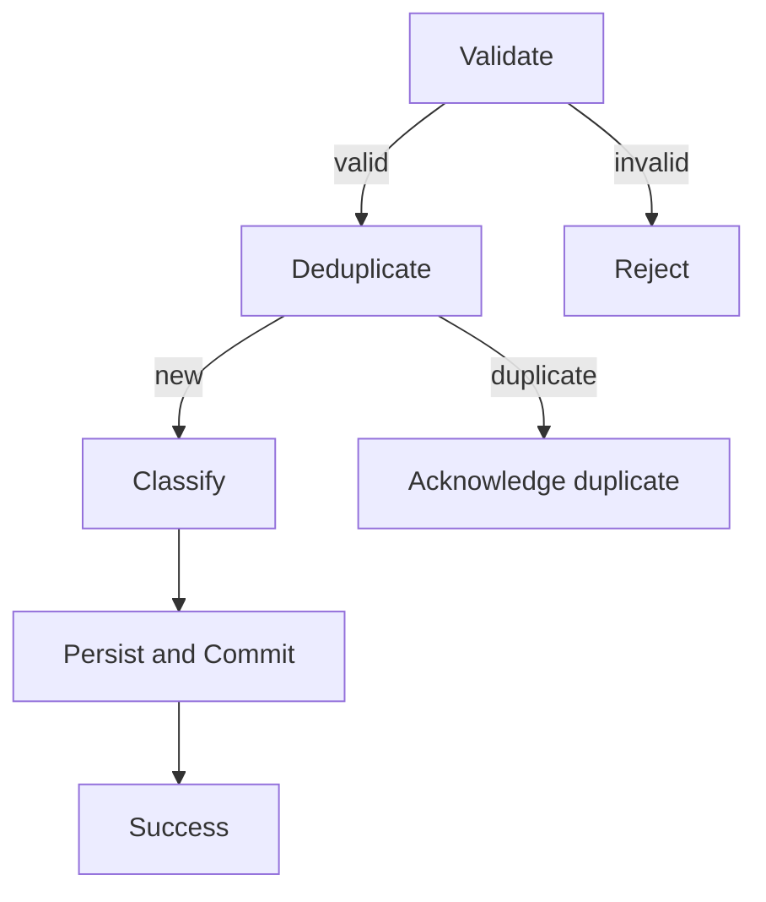

# Arcanum — Incremental workflow and integration framework

Status: working proposal · 2026-11-07

## Purpose

The framework has **two complementary outputs**:

1. **Runtime building blocks** (code): composable workflows and reusable integration components.
2. **Architecture/process documentation** (contracts): a shared vocabulary and templates for workflows, activities, integrations and their operational guarantees.

The V1 does **not** require a standalone framework service. Code begins within Arca and is extracted into `Arcanum.Framework.Workflows` only after real reuse proves the abstraction.

## Architecture layers

Separate three concerns:

1. **Host composition**: infrastructure shared by .NET entry points (Minimal API, Worker, future transports).
2. **Workflow runtime**: transport-neutral business processing and consistent outcomes.
3. **Tessera domain modules**: Arca, Gradus, Clavis, etc., with references to framework contracts, not framework dependencies on domains.

The implementation should start as shared libraries and DI registrations in a **monorepo**, not as independently deployed framework services.

## Host composition — proposed

Use .NET **IHostApplicationBuilder** extensions rather than implementing/subclassing `IHost`:

```csharp
var builder = WebApplication.CreateBuilder(args);
builder.AddArcanumDefaults();
builder.AddArcanumObservability();
builder.AddArcanumAuthentication();
builder.AddArcanumAuthorization();
builder.AddArcanumHttpClients();
builder.AddArcanumWorkflows();
builder.Services.AddTesseraArca();

var app = builder.Build();
app.UseAuthentication();
app.UseAuthorization();
app.MapArcaEndpoints();
app.Run();
```

A Worker uses `Host.CreateApplicationBuilder(args)`, the same applicable builder extensions, and `IHostedService` / `BackgroundService`. HTTP-specific mapping/pipeline configuration remains in the web host; Kafka-specific consumer authentication and processing remain in the worker integration adapter.

**Register only features actually needed**: `AddArcanumDefaults` must be minimal; other additions are opt-in and documented. Configuration must be validated on startup and integration clients must use standard DI, typed options and graceful shutdown.

Candidate capability packages/projects (introduced only on first use):

| Capability | Shared contract / implementation |
| --- | --- |
| Observability + APM | OpenTelemetry traces/metrics/log correlation, structured ILogger, OTLP export, health checks |
| AuthN | Host-specific authentication schemes, claims mapping, test/local provider initially |
| AuthZ | ASP.NET policies + domain-specific authorization service; Clavis evolution |
| HTTP | IHttpClientFactory, typed clients, resilience (timeouts/retries only for safe/idempotent calls), propagation |
| Kafka | Future producer/consumer adapters, async processing, retry/poison messages; no Kafka dependency for Arca V1 |
| Persistence | Explicit local UoW, PostgreSQL adapter, outbox integration |
| Workflows | Typed context, activities, results, composition/execution, instrumentation |

Avoid building alternative implementations of facilities that .NET, OpenTelemetry and other mature libraries already supply. Consider Aspire Service Defaults as a reference implementation or dependency decision, not as a required orchestrator.

## Three distinct pipeline concepts

1. **Transport middleware**: ASP.NET authentication, authorization, exception mapping, request/response handling, etc.
2. **Workflow behaviors**: cross-cutting concerns surrounding workflow execution (structured logs, traces, timeouts, consistent error reporting and optional UoW policies).
3. **Domain activities**: focused business responsibilities such as validate, classify, deduplicate, persist, commit and audit.

Keep activity results **transport-neutral**. HTTP endpoints translate workflow outcomes to status codes/ProblemDetails. Worker consumers translate them to acknowledgement, retry or dead-letter behavior.

### V1 linear execution

For the prototype, assemble an ordered chain of activities with a typed scoped context and a `Next` delegate, consistent with the originally requested Chain-of-Responsibility pattern. The context may expose scoped `IServiceProvider`, but constructor-injected stable dependencies and typed state are preferred. Do not allow activities to write HTTP responses or publish Kafka acknowledgement directly.

Activity results should carry a semantic outcome code, e.g. `completed`, `invalid`, `duplicate`, `unauthorized`, `retryable_failure`. Define clear short-circuit rules, exception handling and local UoW boundaries. Side-effecting activities must not re-execute accidentally because of middleware retries.

Candidate publish activities: authenticate producer → validate contract → check idempotency → resolve effective event/detail classification → persist in UoW → commit → return durable ingestion result. Track each activity's own log/tracing scope. Reuse only where semantic responsibilities match.

## Future graph-directed workflow engine (design opportunity, **not V1**)

Treat a workflow as a **versioned directed graph** of typed activities and transitions. Each activity returns a named outcome; the **engine**, not individual domain activities, chooses the next transition based on that outcome. Branches and conditional outcomes are modeled explicitly. A linear CoR is the simplest graph.



Separate **workflow definition** (id, version, nodes, outcomes, transitions, constraints) from **runtime** (activity instances from DI, context, execution engine) and **visual representation** (editor/diagram). A future graphical tool must not control infrastructure registration, auth middleware ordering or privileged access by arbitrary untrusted configuration.

A graph compiler/validator must check: known activity types, distinct node IDs, valid outgoing outcome names, reachable terminal nodes, cycle policy, resource/side-effect boundaries, maximum execution budget and authorized graph version/publishing. Start with acyclic graphs and deterministic execution; cycles, parallel joins, durable asynchronous resumptions and distributed sagas are separate, later capabilities.

A graph representation can start as a **projection of the code-first workflow**, followed by validation and interpretation only when there is a compelling second use case. Preserve execution traces with workflow id/version and node transitions. Never infer security guarantees from a diagram.

## Workflow specification (document with code)

Each workflow should document:

```yaml
id: audit.publish
owner: tessera.arca
trigger: http.post
contract: audit-event.v1
activities:
  - authenticate-producer
  - validate-contract
  - verify-idempotency
  - classify-event-and-details
  - persist-in-uow
  - commit
outcomes:
  success: durable-ingestion-ack
  rejected: problem-details
audit:
  eligible: true
  recursion_policy: internal-events-do-not-self-audit
observability:
  correlation: request-id,event-uuid
tests:
  - duplicate-delivery
  - invalid-producer
  - conflicting-payload
```

This YAML is an illustrative **documentation pattern**, not a requirement to build a YAML execution engine in V1.

## Integration specification

For each integration, record: producer/consumer, data ownership, versioned contract, protocol, authentication, delivery guarantee (e.g. at-least-once), idempotency key, retry/backoff, timeout, failure handling, metrics/traces and contract tests. Provide an explicit sequence diagram for critical paths.

## Extraction rule

Implement first concrete behavior, then reuse it in a second workflow, then extract a generic building block with tests and docs. Avoid premature general-purpose registries, event buses, plugin engines and external platform services. Maintain an examples folder and diagrams as the framework grows.

## Architectural consistency checks

- Each activity has one clear reason to change.
- The framework does not depend on a particular Tessera business domain.
- Transport-specific HTTP response mapping remains at the API edge.
- No hidden distributed transactions, recursive self-auditing or implicit privilege escalation.
- Each documented integration describes measurable delivery and failure behavior.
